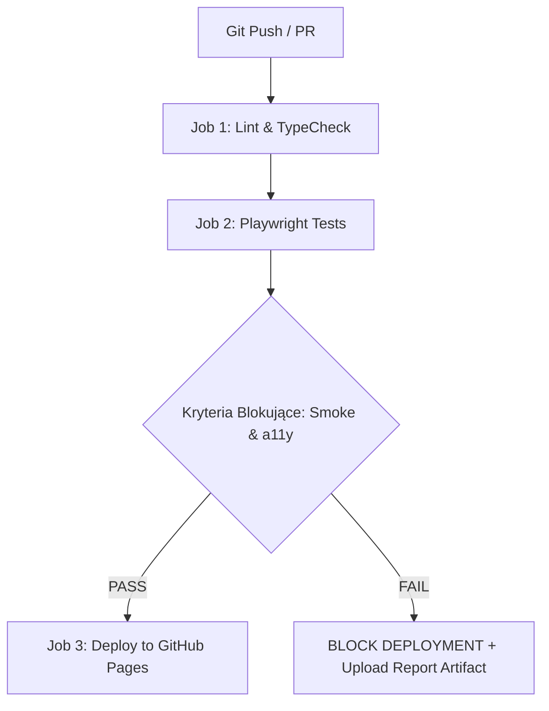

# Master Test Plan - Filozofia Testowania

**Aplikacja / SUT**: [Filozofia Testowania](https://pawel-zygler.github.io/testofilos/)  
**Autor Planu**: Quality Architect / Senior QA Engineer  
**Status**: Aktywny  
**Wersja**: 1.0.0  

---

## 1. Wstęp i Filozofia Jakościowa

> *„Testowanie to poznanie jakości, nie jej zapewnienie. Testowanie nie tworzy jakości, tylko ją obserwuje.”*  
> — Manifest Filozofii Testowania

Celem niniejszego Planu Testów jest wdrożenie dojrzałego ekosystemu inżynierii jakości dla serwisu *Filozofia Testowania*. Plan definiuje kluczowe obszary funkcjonalne (Core Functionality), architekturę bramek jakościowych (CI/CD Quality Gates z blokowaniem wdrożenia) oraz standardy współpracy z deweloperami (Shift-Left i Design for Testability).

---

## 2. Zakres Funkcjonalny i Strategia Testów (Core Functionality)

Serwis został podzielony na 5 krytycznych obszarów weryfikacji:

### 2.1. Wersje językowe (PL i EN) — `@smoke` `@e2e`
- **Zakres**: Weryfikacja dynamicznego mechanizmu przełączania języków bez przeładowywania strony.
- **Kryteria sukcesu**:
  - Domyślny start w języku polskim: aktywny przycisk `PL`, widoczny nagłówek *Filozofia Testowania*, widoczna sekcja `#pl-content`, ukryta sekcja `#en-content`.
  - Przełączenie na język angielski (kliknięcie `EN`): aktywny przycisk `EN`, zmiana nagłówka na *Philosophy of Testing*, podtytułu, tytułu karty (`document.title`), widoczna sekcja `#en-content`, ukryta `#pl-content`.
  - Płynny powrót do języka polskiego (cykl PL -> EN -> PL).

### 2.2. Symetria komponentów i treści (PL vs EN Content Parity) — `@regression` `@data`
- **Zakres**: Jako artykuł naukowo-filozoficzny, witryna musi gwarantować pełną zgodność merytoryczną i strukturalną między obiema wersjami językowymi.
- **Kryteria sukcesu**:
  - **Symetria Spisu Treści (TOC)**: Liczba i kolejność sekcji w polskim spisie treści odpowiada dokładnie sekcjom w spisie angielskim (14 sekcji: Intro, Why, Software, Bug, Consequences, Test, Types, Coverage, Select, Quality, Summary, Laws, Sources, Contact).
  - **Symetria Praw Testowania**: Sekcja `#pl-laws` oraz `#en-laws` zawierają dokładnie 7 fundamentalnych praw testowania (Informacji, Aksjomatu, Asercji, Granic, Ryzyka, Jakości, Inspekcji).
  - **Symetria Przypisów (Footnotes)**: Każdy odnośnik w tekście (`fnref:X`) posiada korespondujący przypis dolny (`fn:X`) z linkiem zwrotnym `↑`.

### 2.3. Linki zewnętrzne i integralność sieciowa (API/Network) — `@links`
- **Zakres**: Weryfikacja wszystkich odnośników wychodzących i źródeł (np. codesimplicity.com, developsense.com, linki ISO).
- **Kryteria sukcesu**:
  - Test skanuje wszystkie znaczniki `<a href>` na stronie.
  - Dla każdego adresu zewnętrznego wykonywane jest żądanie HTTP HEAD/GET (`playwright.request`).
  - Zero niedziałających odnośników (brak kodów HTTP 404, 500, certyfikatów SSL wygasłych).

### 2.4. Dostępność cyfrowa (WCAG 2.1 AA) — `@a11y` (Deployment Blocker)
- **Zakres**: Automatyczny audyt standardów dostępności przy użyciu silnika Axe (`@axe-core/playwright`).
- **Kryteria sukcesu**:
  - Zero krytycznych (`critical`) i poważnych (`serious`) naruszeń reguł WCAG 2.1 poziomu A i AA.
  - Kontrast typografii (`DM Sans` na tle `#fafafa`).
  - Hierarchia nagłówków (`H1` -> `H2` -> `H3`).
  - Etykiety dostępności dla elementów interaktywnych (`aria-label` dla nawigacji TOC).

### 2.5. Regresja wizualna (Visual Snapshot Testing) — `@visual`
- **Zakres**: Weryfikacja czy styl, typografia oraz layout siatki (`.content-grid`) nie uległy niezamierzonemu rozjechaniu.
- **Kryteria sukcesu**:
  - Porównanie zrzutów ekranu (`toHaveScreenshot()`) na widoku Desktop (1280x720) oraz Mobile (375x667).
  - Tolerancja diffa pikseli na poziomie < 1%.

---

## 3. Wdrożenie CI/CD i Bramki Jakościowe (GitHub Actions)

### 3.1. Architektura potoku CI/CD
Pipeline uruchamiany przy każdym zdarzeniu `push` oraz `pull_request` na gałąź `main`.

### 3.2. Kryteria blokowania wdrożenia (Deployment Blocker)
> [!IMPORTANT]
> Jeśli testy z tagiem `@smoke` lub `@a11y` zakończą się błędem:
> 1. Pipeline natychmiast przerywa działanie.
> 2. Kod **nie może** zostać opublikowany na produkcji GitHub Pages.
> 3. Generowany jest kompletny raport HTML oraz nagrania Trace Viewer załączane do artefaktów GitHub Actions.

---

## 4. Partnerstwo z Deweloperami i Testowalność (Shift-Left)

### 4.1. Standard `data-testid` (Design for Testability)
W porozumieniu z zespołem deweloperskim wprowadzamy czytelny kontrakt atrybutów testowych niezależnych od klas CSS:
- Przełącznik języka: `data-testid="lang-switch-pl"`, `data-testid="lang-switch-en"`
- Tytuł główny: `data-testid="main-title"`
- Podtytuł: `data-testid="main-subtitle"`
- Spis treści: `data-testid="toc-navigation"`
- Sekcja Praw: `data-testid="laws-section"`
- Kontakt: `data-testid="contact-email"`

*Uwaga*: Page Object Model w teście wspiera zarówno nowe selektory `[data-testid="..."]`, jak i dotychczasowe ID (`#pl-btn`, `#en-btn`), gwarantując wsteczną kompatybilność.

### 4.2. Mechanizm Shift-Left (Husky + Lint-staged)
Zamiast czekać na pipeline w chmurze, defekty wyłapujemy lokalnie u programisty:
1. Przed wykonaniem `git commit`, hook `pre-commit` uruchamia:
   - `tsc --noEmit` (walidacja typów TypeScript).
   - Formatowanie i linting.
2. Uniemożliwia to committowanie uszkodzonego kodu i oszczędza czas agentów CI/CD.

---

## 5. Macierz Uruchamiania i Tagi Testowe

| Tag | Typ testu | Częstotliwość | Rola w CI/CD |
| :--- | :--- | :--- | :--- |
| `@smoke` | Wersje językowe, start strony | Każdy commit / PR | **Blokada wdrożenia** |
| `@a11y` | Dostępność WCAG 2.1 (Axe) | Każdy commit / PR | **Blokada wdrożenia** |
| `@regression` | Symetria treści, Prawa, TOC | Każdy PR | Weryfikacja merge'a |
| `@links` | Walidacja linków zewnętrznych | Nocny build (Nightly) / PR | Ostrzeżenie / Monitoring |
| `@visual` | Snapshoty wizualne | Na żądanie / PR z CSS | Akceptacja zmian UI |
